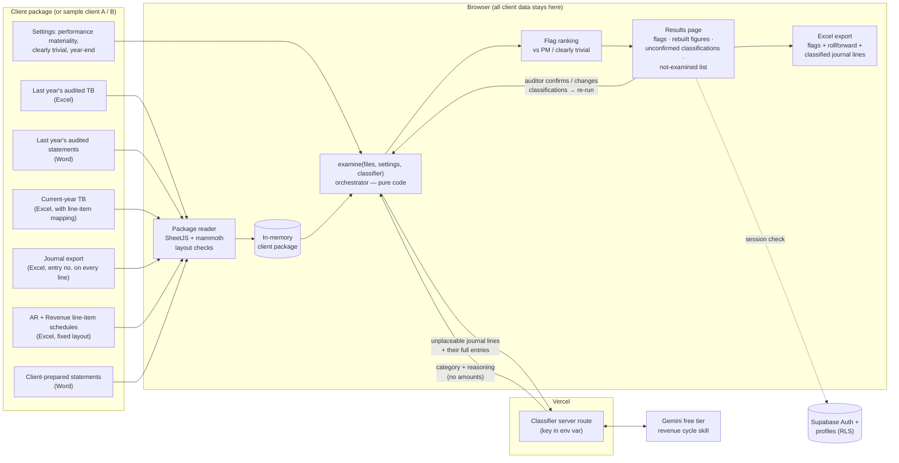
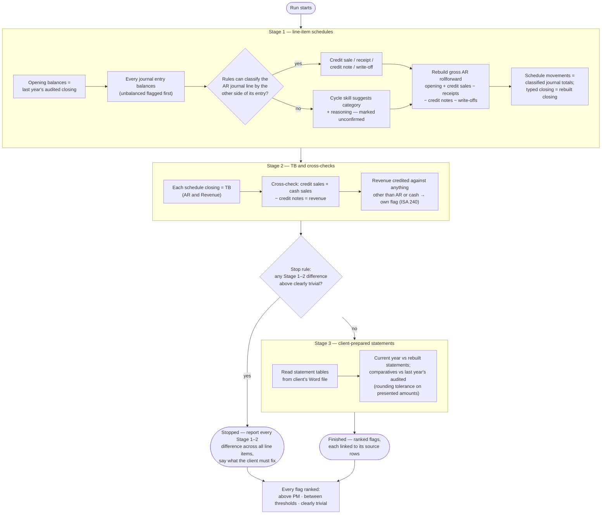
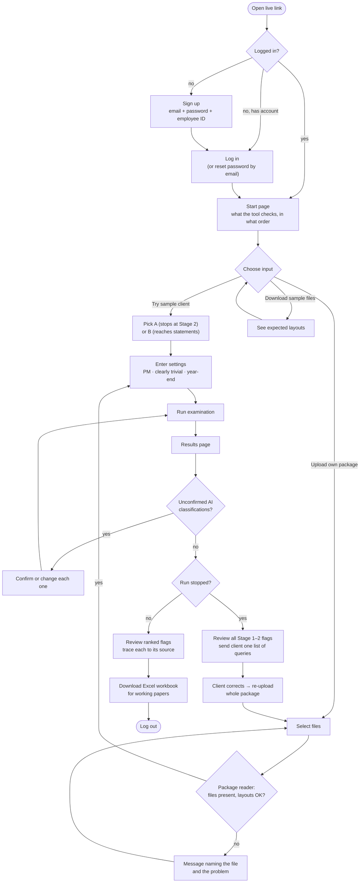
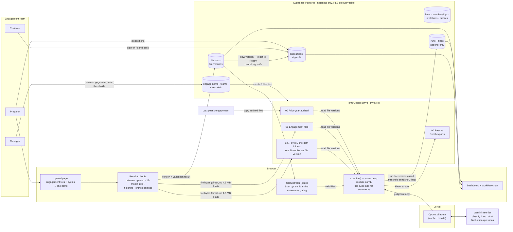
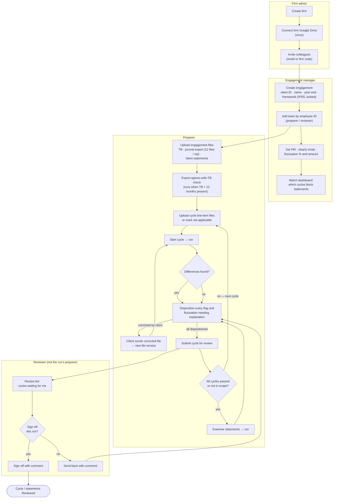
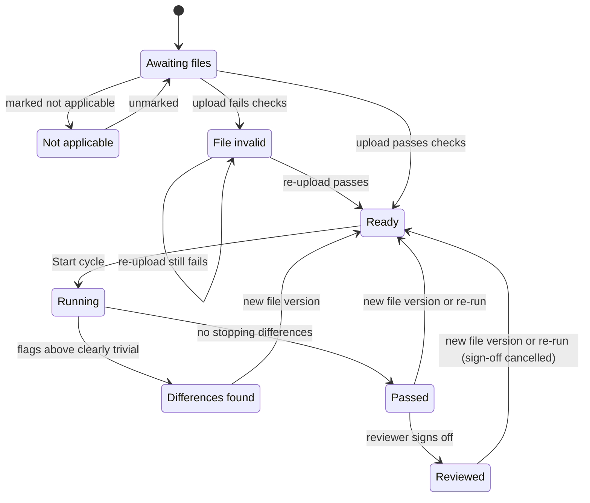
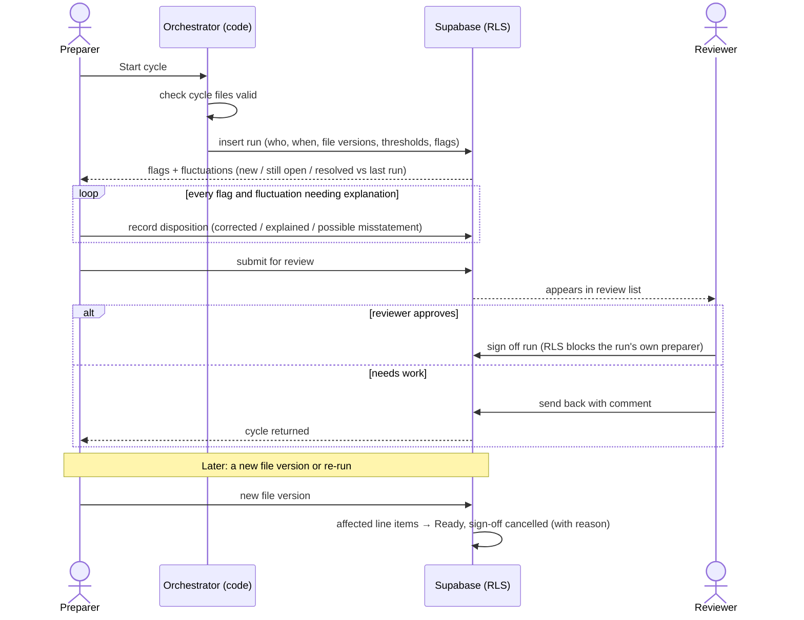

# Audit Workbench — data flow and user workflow

Diagrams of the current plan (`PLAN.md`, specs in issue #1 for v1 and issue #2 for v2). Terms follow `CONTEXT.md`. Rule throughout: deterministic code computes every amount, and the AI only classifies, compares wording and drafts text (ADR 0001).

1. [v1 system data flow](#1-v1-system-data-flow)
2. [Examination pipeline (stages and stop rule)](#2-examination-pipeline-stages-and-stop-rule)
3. [v1 user workflow](#3-v1-user-workflow)
4. [v2 platform data flow](#4-v2-platform-data-flow)
5. [v2 engagement workflow by role](#5-v2-engagement-workflow-by-role)
6. [v2 line-item status](#6-v2-line-item-status)
7. [v2 sign-off lifecycle](#7-v2-sign-off-lifecycle)

---

## 1. v1 system data flow

Client files never leave the browser. The only data sent to a server is the journal lines the rules can't classify, and those go to the classifier route. The database holds user profiles and nothing else.

---

## 2. Examination pipeline (stages and stop rule)

What happens inside one run of `examine`. v1 covers the revenue cycle and the balance sheet + income statement in Stage 3. The full design (v2+) adds the allowance rollforward, cash and VAT cross-checks, shallow checks for every line item, the cash flow statement and notes wording.

---

## 3. v1 user workflow

---

## 4. v2 platform data flow

Files still go from the browser straight to the firm's Google Drive and are still examined in the browser. Supabase stores metadata only: who, what, which file version and which flags, never client figures.

---

## 5. v2 engagement workflow by role

---

## 6. v2 line-item status

A cycle's status is the worst status among its line items.

---

## 7. v2 sign-off lifecycle

