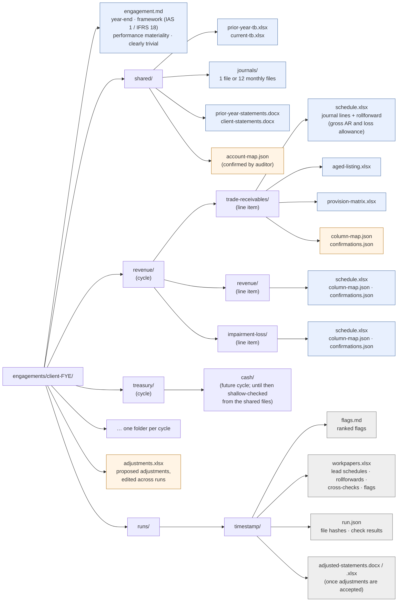
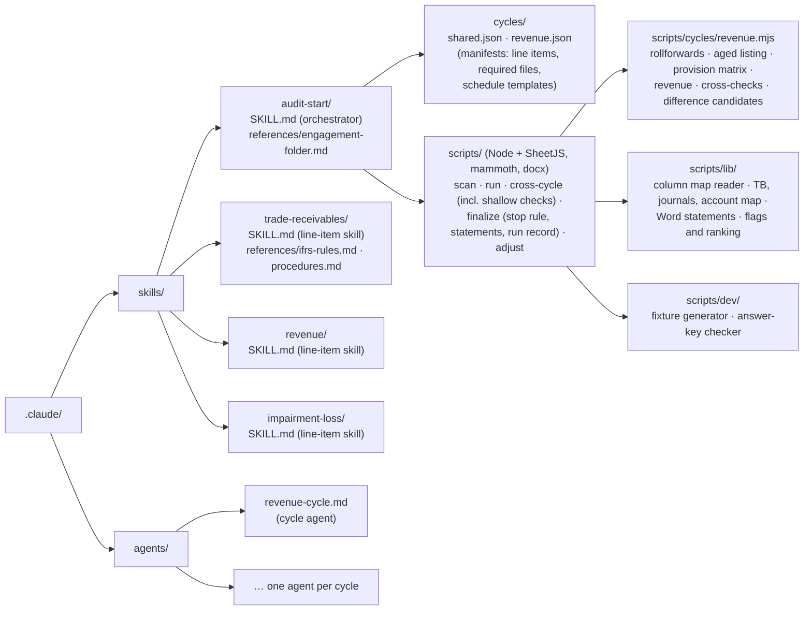
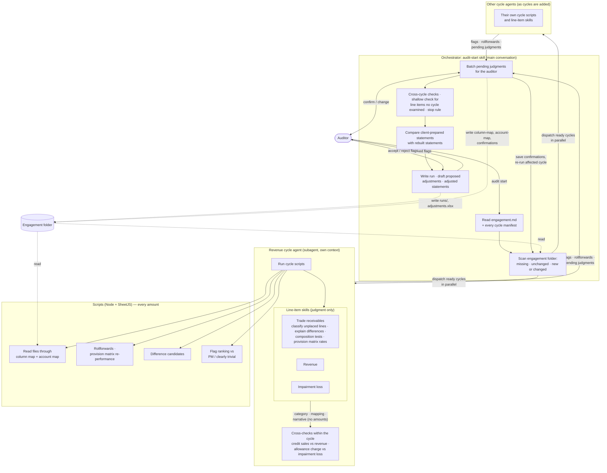
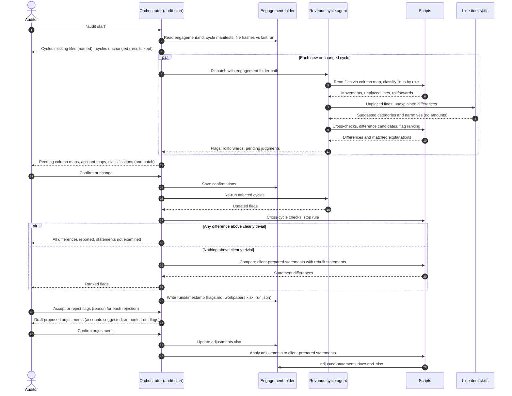
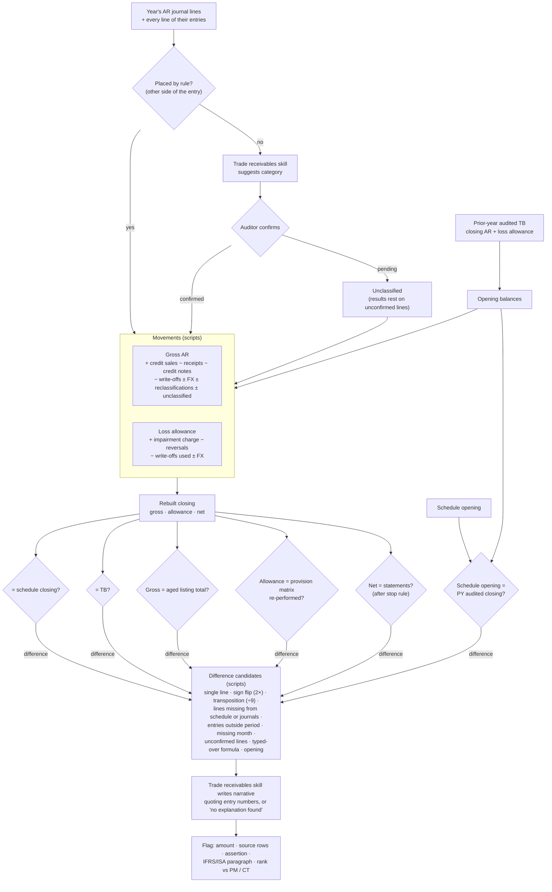

# Audit examination as Claude Code skills: folder and harness diagrams

Diagrams of the design agreed on 2026-11-17 (ADR 0002). Terms follow `CONTEXT.md`. Rule throughout: scripts compute every amount; agents only map, classify, explain and draft (ADR 0001).

1. [Engagement folder](#1-engagement-folder)
2. [Harness files in the repo](#2-harness-files-in-the-repo)
3. [Agent harness structure](#3-agent-harness-structure)
4. ["Audit start" run sequence](#4-audit-start-run-sequence)
5. [Trade receivables rollforward check](#5-trade-receivables-rollforward-check)

---

## 1. Engagement folder

One folder per engagement, gitignored. The auditor uploads into `shared/` and the line-item folders. Agents write only the mapping and confirmation files (after the auditor confirms), `adjustments.xlsx`, and new runs. Runs are never edited.

Legend: blue = uploaded or set by the auditor · amber = written by an agent after the auditor confirms · grey = run output, never edited.

---

## 2. Harness files in the repo

Where the skills, agents, manifests and scripts live (as built). Adding a cycle means adding a manifest, a cycle script, one agent and its line-item skills; the orchestrator does not change. Manifests are JSON inside the orchestrator skill because the scripts read them too, and all scripts share one Node package.

---

## 3. Agent harness structure

Who calls whom, and what each reads and writes. Agents never produce an amount: every number comes from a script.

---

## 4. "Audit start" run sequence

One run, from the auditor's command to adjusted statements.

---

## 5. Trade receivables rollforward check

The check inside the revenue cycle: last year's audited closing as the opening, the whole year's AR journal lines as movements, and the rebuilt closing compared with the client's closing balances.

